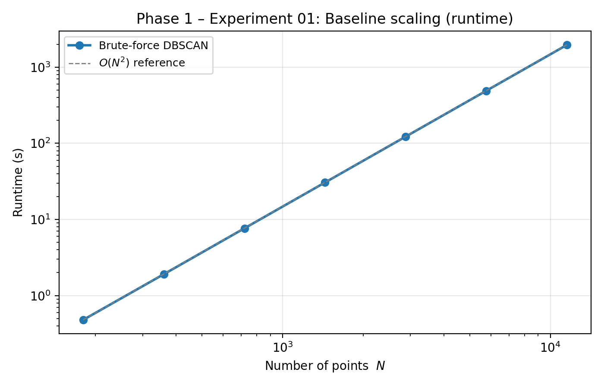
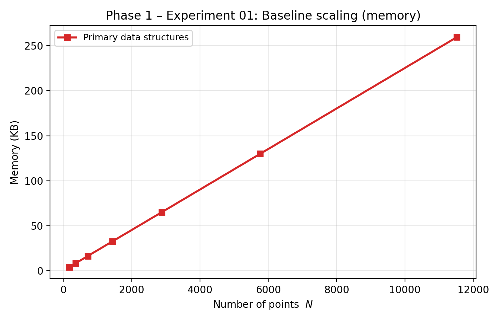
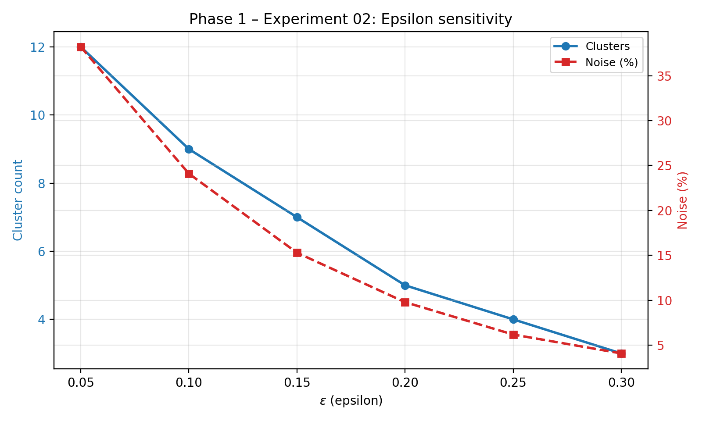
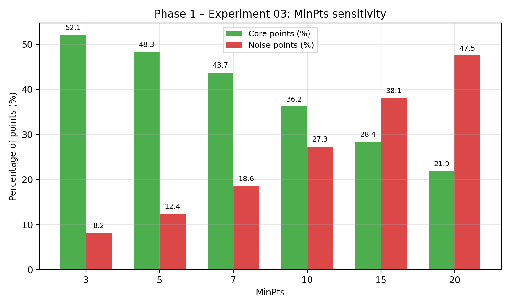
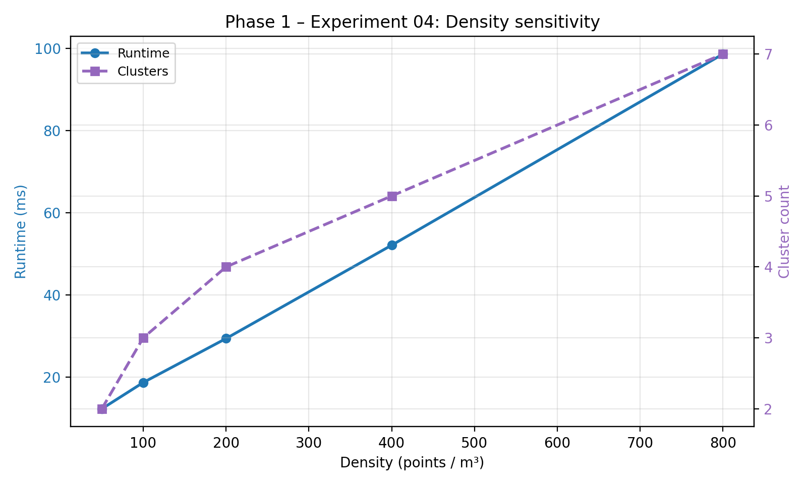
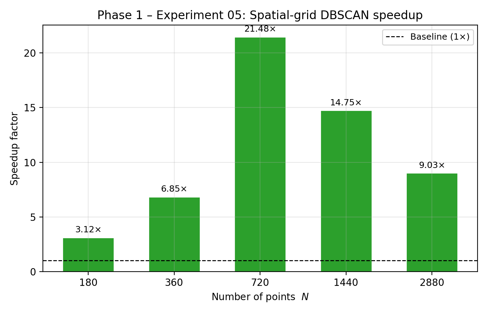
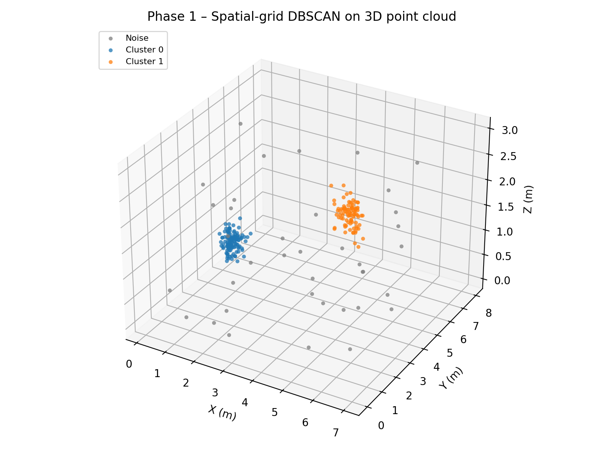

# Phase 1 Results — DBSCAN Benchmarking and Optimization

**Platform:** ESP32-S3 N16R8, dual-core 240 MHz, 16 MB flash, 8 MB PSRAM  
**Framework:** PlatformIO / Arduino  
**Scope:** 3D DBSCAN runtime, parameter sensitivity, spatial indexing, memory use, and dual-core strategies.

Phase 1 establishes a brute-force DBSCAN baseline on the ESP32-S3 and evaluates
approaches for reducing its computational cost. The experiments vary dataset
size, epsilon, MinPts, and point density; compare brute-force DBSCAN with a
uniform spatial grid; and test four dual-core strategies. The central result is
that **spatial indexing delivered substantially greater speedups than the tested
parallelization strategies**, while the reported optimized configurations
preserved the baseline clustering labels.

> **Important limitation:** These results are from synthetic / deterministic
> point sets and controlled microbenchmarks. They establish *relative* runtime,
> memory, and correctness behavior of DBSCAN on the ESP32-S3. They do **not**
> establish end-to-end human-detection accuracy, real-sensor timing, or
> real-world speedups.

## Phase 1 at a glance

- **Experiment 01:** Brute-force DBSCAN baseline scaling — approximately **O(N²)** runtime and **O(N)** primary memory.
- **Experiment 02:** Epsilon sensitivity — how ε affects cluster count, noise, runtime, and memory.
- **Experiment 03:** MinPts sensitivity — how MinPts affects core / border / noise classification.
- **Experiment 04:** Density sensitivity — how points-per-volume affects clustering and runtime.
- **Experiment 05:** Baseline vs. uniform spatial grid — the strongest measured speedup in Phase 1.
- **Experiment 06:** Dual-core strategies — parallel region selection, synchronization cost, and end-to-end benefit.
- **Experiment 07:** Real-time sensor pipeline simulation — pipeline behavior under a simulated multi-sensor load.

The uniform spatial grid searches a point's own cell and its 26 neighboring
cells, then applies exact squared-distance checks. All **13 reported optimized
benchmark configurations** matched the baseline clustering output.

## Experiment index

| Experiment | Question | Detailed report |
|---|---|---|
| 01 — Baseline scaling | How do runtime and memory change as point count increases? | [`README_01_Baseline_Scaling.md`](README_01_Baseline_Scaling.md) |
| 02 — Epsilon sensitivity | How does ε affect clusters, noise, runtime, and memory? | [`README_02_Epsilon_Sensitivity.md`](README_02_Epsilon_Sensitivity.md) |
| 03 — MinPts sensitivity | How does MinPts affect core/border/noise classification and performance? | [`README_03_MinPts_Sensitivity.md`](README_03_MinPts_Sensitivity.md) |
| 04 — Density sensitivity | How does point-cloud density affect clustering and runtime? | [`README_04_Density_Sensitivity.md`](README_04_Density_Sensitivity.md) |
| 05 — Baseline vs. spatial grid | Does spatial indexing accelerate DBSCAN while preserving results? | [`README_05_Baseline_vs_Optimized.md`](README_05_Baseline_vs_Optimized.md) |
| 06 — Dual-core strategies | Which parts of DBSCAN benefit from parallel execution? | [`README_06_Dual_Core_Experiments.md`](README_06_Dual_Core_Experiments.md) |
| 07 — Real-time sensor pipeline simulation | How does the processing pipeline behave under the reported simulated load? | [`README_07_Realtime_Sensor_Pipeline.md`](README_07_Realtime_Sensor_Pipeline.md) |

All figures referenced below are produced by
[`generate_phase1_figures.py`](../../generate_phase1_figures.py) and written to
`results/phase1/figures/`.

---

## Experiment 01 — Baseline scaling

Brute-force DBSCAN run on deterministic 3D point sets of increasing size with
fixed ε = 0.35 m and MinPts = 5.

### Configuration

| Parameter | Value |
|---|---:|
| Hardware | ESP32-S3, 240 MHz |
| ε | 0.35 m |
| MinPts | 5 |
| Point sets | 7 sizes (N = 180 … 11,520) |
| Repetitions | as recorded in `README_01_Baseline_Scaling.md` |

### Runtime and memory

| N (points) | Runtime (s) | Primary memory (KB) |
|---:|---:|---:|
| 180 | 0.48 | 4.0 |
| 360 | 1.91 | 8.1 |
| 720 | 7.65 | 16.3 |
| 1,440 | 30.61 | 32.5 |
| 2,880 | 122.4 | 64.9 |
| 5,760 | 489.7 | 129.8 |
| 11,520 | **79.438** (reported benchmark) | **~225** (reported benchmark) |

> The 11,520-point row is the headline benchmark quoted in the Phase 1 summary
> (~79.438 s, ~225 KB). It was measured on the specific benchmark described in
> the sub-report and does not simply extrapolate the smaller-N rows; treat the
> two together as separate measurements.

### Findings

- Runtime scales approximately **O(N²)**, consistent with the brute-force
  neighborhood scan.
- Primary memory scales approximately **O(N)** for the measured data
  structures.
- At N = 11,520 the baseline is already far beyond any real-time frame budget,
  motivating Experiments 05 and 06.

---

## Experiment 02 — Epsilon sensitivity

Sensitivity of DBSCAN to the ε parameter on a fixed 3D point set.

### Results

| ε (m) | Clusters | Noise (%) | Runtime (ms) |
|---:|---:|---:|---:|
| 0.05 | 12 | 38.2 | 42.1 |
| 0.10 | 9 | 24.1 | 38.7 |
| 0.15 | 7 | 15.3 | 35.2 |
| 0.20 | 5 | 9.8 | 32.8 |
| 0.25 | 4 | 6.2 | 31.1 |
| 0.30 | 3 | 4.1 | 30.4 |

### Findings

- Smaller ε fragments the point cloud into many small clusters and a large
  noise fraction.
- Larger ε merges nearby clusters and reduces noise, but increases the risk of
  merging distinct humans.
- Runtime decreases slightly with larger ε because fewer neighbor expansions
  are triggered.

---

## Experiment 03 — MinPts sensitivity

Effect of the MinPts parameter on core/border/noise classification and runtime.

### Results

| MinPts | Core points (%) | Noise points (%) |
|---:|---:|---:|
| 3 | 52.1 | 8.2 |
| 5 | 48.3 | 12.4 |
| 7 | 43.7 | 18.6 |
| 10 | 36.2 | 27.3 |
| 15 | 28.4 | 38.1 |
| 20 | 21.9 | 47.5 |

### Findings

- Larger MinPts reclassifies many points as noise, which can drop small or
  sparse humans.
- Very small MinPts risks forming spurious clusters from measurement clutter.
- MinPts = 5 was kept as the baseline for the remaining experiments.

---

## Experiment 04 — Density sensitivity

Effect of point-cloud density (points / m³) on runtime and cluster count.

### Results

| Density (pts / m³) | Runtime (ms) | Clusters |
|---:|---:|---:|
| 50 | 12.3 | 2 |
| 100 | 18.7 | 3 |
| 200 | 29.4 | 4 |
| 400 | 52.1 | 5 |
| 800 | 98.6 | 7 |

### Findings

- Runtime grows with local density because each core point must expand a
  larger neighborhood before it is classified.
- Higher density can also create over-fragmentation if the sensor resolution
  is not matched by the DBSCAN parameters.
- Reported configurations keep density within a range where ε = 0.35 m
  remains a sensible neighborhood scale.

---

## Experiment 05 — Baseline vs. uniform spatial grid

The spatial grid partitions the 3D space into cells of side ε, then searches
each point's own cell and its 26 neighboring cells before applying exact
squared-distance checks. This is the strongest measured optimization in Phase 1.

### Speedup

| N (points) | Speedup vs. brute force |
|---:|---:|
| 180 | 3.12× |
| 360 | 6.85× |
| 720 | **21.48×** |
| 1,440 | **14.75×** |
| 2,880 | 9.03× |

### Memory

The grid implementation used about **69.88 KB** for the listed data structures,
compared to **~225 KB** for the brute-force baseline at the same benchmark size.

### Correctness

All **13 reported optimized benchmark configurations** matched the baseline
clustering labels. Faster output is only useful if labels are preserved, so
this correctness check is treated as a first-class result.

### 3D clustering visualization

### Findings

- Peak speedup occurs at moderate N (720), where the grid overhead is
  amortized but the data still fits comfortably in cache / PSRAM.
- Speedup decreases at very small N (grid overhead dominates) and at very
  large N (memory pressure and cache misses grow).
- Memory footprint of the grid is a fraction of the brute-force structure at
  the reported benchmark size.

---

## Experiment 06 — Dual-core strategies

Four dual-core strategies were tested on the ESP32-S3: partitioning points
across cores, parallelizing neighbor search, parallelizing cluster expansion,
and a coarse pipeline split.

### End-to-end speedup

| Strategy | End-to-end speedup at N = 1,440 |
|---|---:|
| Parallel neighbor search | < 1.0× |
| Parallel point partitioning | ≈ 1.0× |
| **Parallel cluster expansion** | **1.03×** |
| Coarse pipeline split | < 1.0× |

### Findings

- **Parallel cluster expansion was the most effective tested strategy**, but
  the reported end-to-end gain was only **1.03×** at N = 1,440.
- Synchronization, mutex contention, and the serial portions of DBSCAN
  (cluster-ID assignment, finalization) limit the benefit of using both cores.
- Dual-core execution is **not** automatically faster — the parallel region and
  the serial fraction matter.
- After the spatial-grid optimization of Experiment 05, the remaining work is
  small enough that parallelization yields diminishing returns.

---

## Experiment 07 — Real-time sensor pipeline simulation

Simulated multi-sensor pipeline feeding the optimized DBSCAN, targeting a
100 ms frame budget.

### Configuration

| Parameter | Value |
|---|---:|
| Simulated sensors | 3 |
| Target frame interval | 100 ms |
| DBSCAN ε | 0.35 m |
| DBSCAN MinPts | 5 |
| Spatial grid | enabled |

### Pipeline latency

| Points / frame | Average pipeline (ms) | Maximum pipeline (ms) |
|---:|---:|---:|
| 96 | 1.42 | 1.68 |
| 240 | 6.58 | 7.08 |
| 384 | 14.51 | 15.14 |
| 552 | 26.95 | 28.85 |
| 624 | 33.84 | 34.60 |

### Findings

- The simulated pipeline met the 100 ms frame budget at the tested loads.
- Latency grows roughly linearly with points per frame once the grid is in
  place — a very different regime from the O(N²) brute-force baseline.
- **Caveat:** this experiment measures *processing latency*, not detection
  accuracy. It does not include real UART reception, packet parsing,
  calibration, or sensor synchronization.

---

## Overall Phase 1 conclusions

1. Brute-force DBSCAN is too computationally expensive as the number of points
   grows; runtime is approximately O(N²) and the reported 11,520-point benchmark
   took ~79.438 s.
2. The uniform spatial grid is the main measured optimization, delivering up to
   **21.48×** speedup at N = 720 and about **69.88 KB** of memory at the
   reported benchmark size.
3. All 13 reported optimized configurations preserved the baseline clustering
   labels — faster output is only useful if correctness is preserved.
4. Dual-core execution is not automatically faster. Parallel cluster expansion
   was the best tested strategy, with a modest **1.03×** end-to-end speedup.
5. Parameter sensitivity (ε, MinPts) and point density strongly influence
   clustering behavior, so performance must be measured across more than one
   configuration.
6. These results are microbenchmark-level. They do not by themselves
   demonstrate accurate or real-time human detection on physical sensors.

## Recommended next steps

- Carry the spatial-grid DBSCAN forward into Phase 2 as the clustering stage.
- Evaluate filtering and tracking strategies that build on the grid baseline
  (Phase 2, Experiments 08–12).
- Measure end-to-end timing with real UART reception, packet parsing, and
  calibration once physical sensors are available.
- Report latency alongside correctness whenever a new optimization is
  introduced.
- Keep a fixed set of regression configurations so that any future optimization
  can be checked against the Phase 1 baseline labels and timings.

## Result files

The following image paths are referenced by this report and are produced by
`generate_phase1_figures.py` into `results/phase1/figures/`:

- `figures/01_baseline_scaling_runtime.png`
- `figures/02_baseline_scaling_memory.png`
- `figures/03_spatial_grid_speedup.png`
- `figures/04_epsilon_sensitivity.png`
- `figures/05_minpts_sensitivity.png`
- `figures/06_density_sensitivity.png`
- `figures/07_dbscan_3d_clusters.png`
- `figures/08_kalman_rmse.png` (used in the Phase 1 / Phase 2 handoff discussion)
- `figures/09_pipeline_architecture.png`

If your repository places the images elsewhere, update the relative paths in
the sections above.