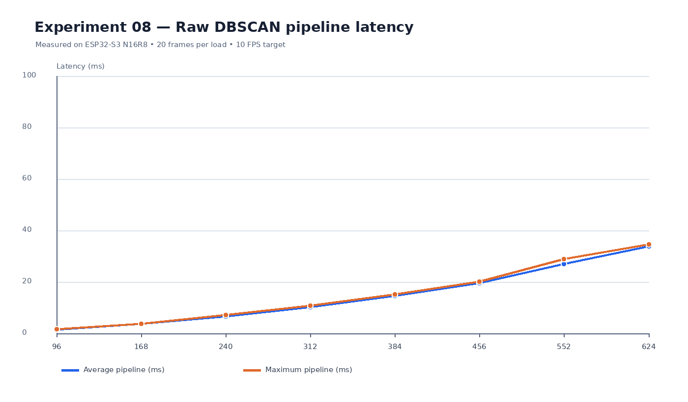
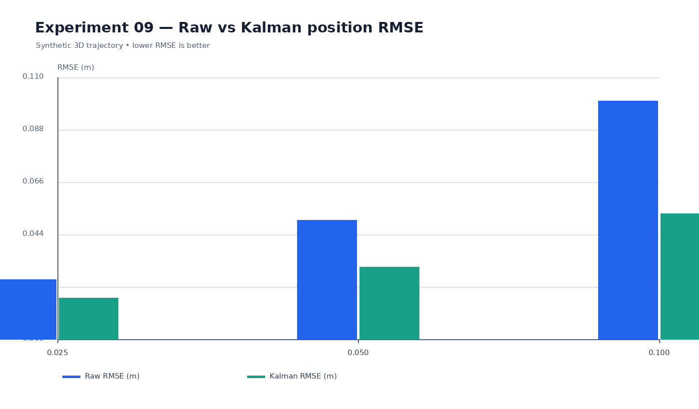
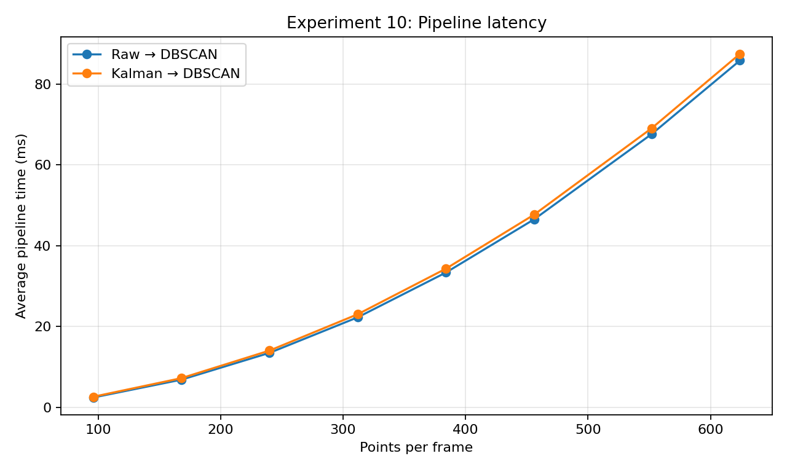
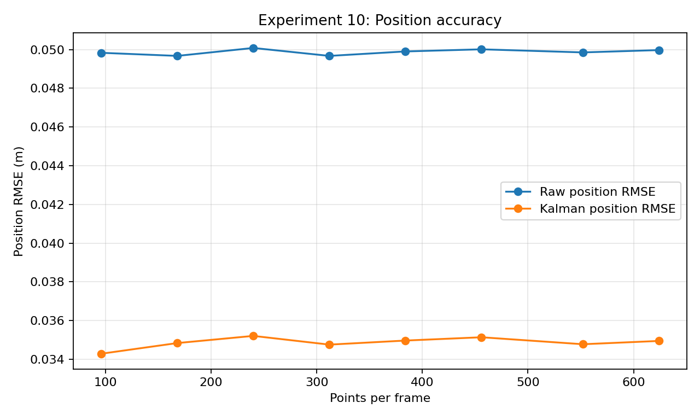
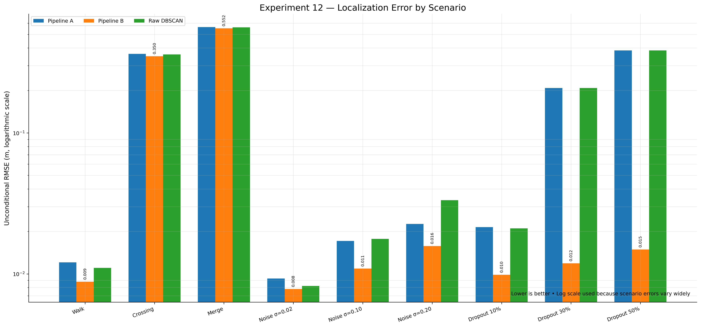
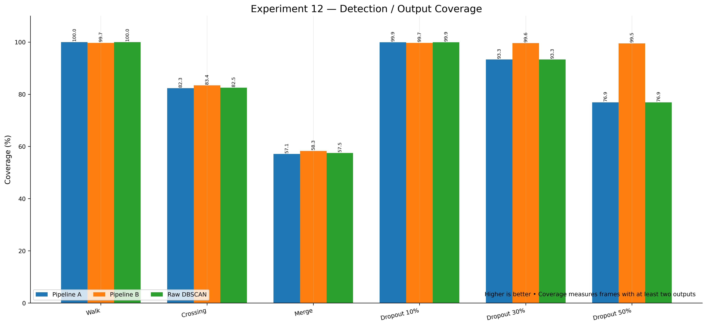
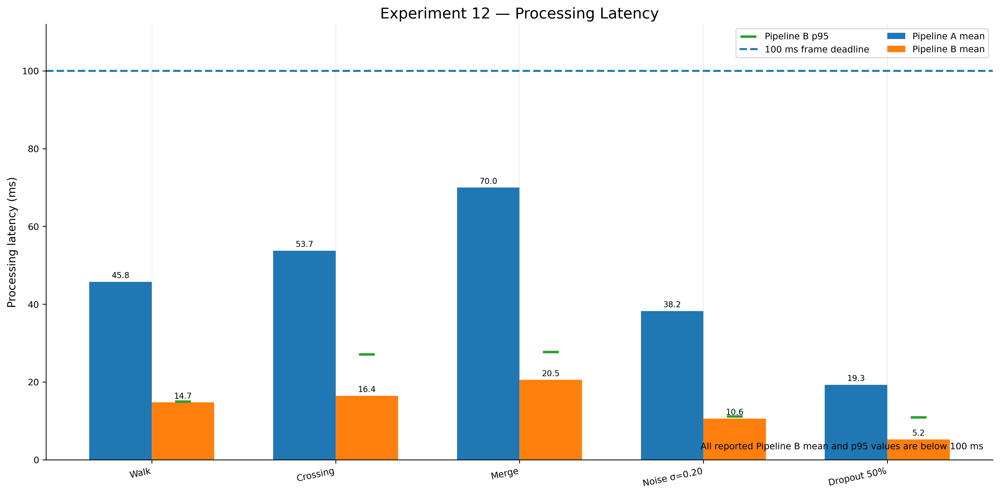

# ESP32-S3 Human Detection — Phase 2 Results

**Platform:** ESP32-S3 N16R8, dual-core 240 MHz, 8 MB PSRAM  
**Framework:** PlatformIO / Arduino  
**Target frame rate:** 10 FPS (100 ms per frame)  
**Scope:** Synthetic three-sensor point-cloud experiments; real-sensor validation remains future work.

Phase 2 moves beyond benchmarking DBSCAN in isolation and evaluates how filtering and tracking can support a real-time human-detection pipeline. The experiments compare raw spatial-grid DBSCAN, Kalman filtering, and Kalman tracking of DBSCAN cluster centroids.

> **Important limitation:** These results are from synthetic data and controlled simulations. They do not establish real-world detection accuracy or guarantee the same timing with physical sensors, UART reception, packet parsing, calibration, or sensor synchronization.

## Phase 2 at a glance

- **Experiment 08:** Raw three-sensor pipeline with spatial-grid DBSCAN, without Kalman filtering.
- **Experiment 09:** 3D constant-velocity Kalman filter microbenchmark.
- **Experiment 10:** Raw DBSCAN compared with Kalman filtering before DBSCAN, using stable synthetic point identities.
- **Experiment 12:** Three-pipeline comparison: Kalman → DBSCAN, DBSCAN → centroid → Kalman tracking, and raw DBSCAN.

Experiment 10's raw-versus-filtered point comparison and Experiment 12's human-level tracking comparison answer different questions. Point-level filtering assumes persistent point identity; centroid tracking filters human-level cluster measurements after clustering.

## Experiment 08 — Raw pipeline baseline

Three-sensor simulation using spatial-grid DBSCAN without Kalman filtering.

| Points/frame | Average pipeline (ms) | Maximum pipeline (ms) | Frame overruns |
|---:|---:|---:|---:|
| 96 | 1.423 | 1.681 | 0/20 |
| 168 | 3.638 | 3.788 | 0/20 |
| 240 | 6.579 | 7.080 | 0/20 |
| 312 | 10.207 | 10.725 | 0/20 |
| 384 | 14.508 | 15.137 | 0/20 |
| 456 | 19.519 | 20.122 | 0/20 |
| 552 | 26.951 | 28.852 | 0/20 |
| 624 | 33.840 | 34.601 | 0/20 |

All tested loads met the 100 ms target in their 20-frame samples. At 624 points/frame, the average pipeline latency was 33.840 ms and the maximum observed latency was 34.601 ms.

**Caveat:** Cluster output sometimes contained more than two human-like clusters. Detection quality was not validated by timing alone; sensor-coordinate transforms and clustering behavior require further inspection.

## Experiment 09 — Kalman filter microbenchmark

A 3D constant-velocity Kalman filter was evaluated against a synthetic trajectory at three measurement-noise levels. The covariance update was corrected after the first run.

| Measurement noise σ (m) | Raw RMSE (m) | Filtered RMSE (m) | RMSE reduction |
|---:|---:|---:|---:|
| 0.025 | 0.02500 | 0.01730 | 30.79% |
| 0.050 | 0.04991 | 0.03031 | 39.28% |
| 0.100 | 0.09999 | 0.05279 | 47.21% |

| Processing metric | Measured result |
|---|---:|
| Average 3D update time | 3.449–3.473 μs |
| Maximum observed update | 11–12 μs |
| Estimated update throughput | About 288,000 updates/s |
| Free heap after test | About 372 KB |
| Free PSRAM | About 8.39 MB |

The filter reduced synthetic position RMSE at all three noise levels. The throughput estimate is based on the measured per-update time, not an end-to-end pipeline benchmark.

**Key limitation:** Filtering individual points requires reliable point association between frames. A point's array index alone is not a valid identity guarantee.

## Experiment 10 — Raw DBSCAN vs. Kalman before DBSCAN

**Configuration:** ε = 0.35 m, MinPts = 5, σ = 0.05 m, Q = 0.8, 20 frames per load. Both pipelines used the same generated measurements. Synthetic tracked points retained stable identities; 24 clutter points per frame were not filtered.

### Pipeline latency

| Points/frame | Raw average (ms) | Kalman average (ms) | Added time (ms) |
|---:|---:|---:|---:|
| 96 | 2.453 | 2.641 | 0.188 |
| 168 | 6.867 | 7.243 | 0.376 |
| 240 | 13.506 | 14.074 | 0.568 |
| 312 | 22.300 | 23.061 | 0.761 |
| 384 | 33.376 | 34.332 | 0.956 |
| 456 | 46.539 | 47.698 | 1.159 |
| 552 | 67.637 | 69.078 | 1.441 |
| 624 | 85.821 | 87.461 | 1.640 |

### Position accuracy

| Points/frame | Raw RMSE (m) | Kalman RMSE (m) | RMSE reduction |
|---:|---:|---:|---:|
| 96 | 0.04983 | 0.03429 | 31.19% |
| 168 | 0.04967 | 0.03484 | 29.85% |
| 240 | 0.05008 | 0.03521 | 29.69% |
| 312 | 0.04967 | 0.03476 | 30.02% |
| 384 | 0.04990 | 0.03497 | 29.93% |
| 456 | 0.05001 | 0.03514 | 29.74% |
| 552 | 0.04985 | 0.03478 | 30.23% |
| 624 | 0.04997 | 0.03495 | 30.06% |

### Findings

- Kalman filtering reduced synthetic point-position RMSE by about 30% across all tested loads.
- The filtering stage added about 0.188–1.640 ms per frame.
- Both pipelines reported 0/20 frame overruns at every tested load.
- At 624 points/frame, the Kalman pipeline averaged 87.461 ms, below the 100 ms target with about 12.5 ms average headroom.
- Both pipelines reported two large clusters in the sampled first and last frames, with the measured large-cluster range remaining 2..2 in this synthetic scene.

The test does not resolve point association for real, unlabeled point clouds. The stable identities are supplied by the simulation.

## Experiment 12 — Comparing detection and tracking pipelines

This simulation compared three approaches for two moving humans observed by three simulated sensors.

### Pipelines

1. **Pipeline A — Kalman → DBSCAN:** Filter points before clustering.
2. **Pipeline B — DBSCAN → centroid → Kalman:** Cluster first, extract centroids, then track the human-level measurements.
3. **Baseline — Raw DBSCAN:** Extract cluster centroids without the additional human-level Kalman tracking stage.

### Configuration

| Parameter | Value |
|---|---:|
| Hardware | ESP32-S3, 240 MHz |
| Sensors in simulation | 3 |
| Simulated humans | 2 |
| Points per human per sensor | 40 |
| Noise points per sensor | 8 |
| Maximum points per complete frame | 264 |
| Frame interval | 100 ms |
| DBSCAN ε | 0.35 m |
| DBSCAN MinPts | 5 |
| Default measurement noise σ | 0.05 m |
| Frames per scenario | 300 |
| Warm-up frames | 50 |
| Random seeds | 5 |

All data and trajectories in this experiment were synthetic.

### Localization accuracy

The reported unconditional RMSE includes the experiment's missed-target penalty. Lower is better.

| Scenario | Pipeline A (m) | Pipeline B (m) | Raw DBSCAN (m) |
|---|---:|---:|---:|
| Normal walking | 0.01208 | **0.00880** | 0.01103 |
| Crossing | 0.36352 | **0.34983** | 0.35990 |
| Merging | 0.56289 | **0.55221** | 0.55995 |
| Low noise, σ = 0.02 | 0.00928 | **0.00781** | 0.00821 |
| Medium noise, σ = 0.10 | 0.01712 | **0.01092** | 0.01771 |
| High noise, σ = 0.20 | 0.02262 | **0.01576** | 0.03335 |
| 10% dropout | 0.02144 | **0.00985** | 0.02105 |
| 30% dropout | 0.20794 | **0.01188** | 0.20796 |
| 50% dropout | 0.38416 | **0.01488** | 0.38420 |

Pipeline B had the lowest reported RMSE in all nine scenarios. The large apparent advantage during dropout should be rechecked against the prediction-only track logic and missed-target scoring.

### Tracking coverage

Coverage is the percentage of scored frames with at least two outputs. Coverage does not itself prove that those outputs correspond to the correct people.

| Scenario | Pipeline A | Pipeline B | Raw DBSCAN |
|---|---:|---:|---:|
| Normal walking | 100.0% | 99.7% | 100.0% |
| Crossing | 82.3% | 83.4% | 82.5% |
| Merging | 57.1% | 58.3% | 57.5% |
| 10% dropout | 99.9% | 99.7% | 99.9% |
| 30% dropout | 93.3% | 99.6% | 93.3% |
| 50% dropout | 76.9% | 99.5% | 76.9% |

### Processing latency

The frame deadline is 100 ms.

| Scenario | Pipeline A mean (ms) | Pipeline B mean (ms) | Pipeline B p95 (ms) |
|---|---:|---:|---:|
| Normal walking | 45.75 | 14.74 | 14.95 |
| Crossing | 53.74 | 16.44 | 27.07 |
| Merging | 69.98 | 20.52 | 27.69 |
| High noise | 38.23 | 10.60 | 11.12 |
| 50% dropout | 19.26 | 5.24 | 10.87 |

Pipeline B's mean latency was approximately 2.6–3.9 times lower than Pipeline A across the reported scenarios. The reported Pipeline B p95 latency stayed below 28 ms in these scenarios.

### Interpretation

- **Best current candidate:** DBSCAN → centroid extraction → Kalman tracking (Pipeline B).
- **Why it is promising:** It filters human-level centroid measurements rather than running a Kalman filter for every raw point.
- **Dropout behavior:** Tracks can maintain outputs during missing measurements, but track lifetime and false/stale outputs must be tested explicitly.
- **Main challenge:** Merging two people into one DBSCAN cluster can deprive the tracker of two separate measurements.
- **Validation caveat:** The reported scores depend on synthetic data and the benchmark's scoring logic; verify prediction-only tracks, missed-target penalties, identity assignment, and identity switches before treating the comparison as conclusive.

## Overall Phase 2 conclusions

1. The raw spatial-grid DBSCAN simulation met the 100 ms frame deadline up to 624 points/frame in the tested 20-frame runs.
2. A 3D Kalman filter reduced synthetic point-position RMSE in the microbenchmark, with an average update time of roughly 3.5 μs.
3. Filtering before DBSCAN reduced synthetic point RMSE by about 30%, with an additional 0.188–1.640 ms per frame in Experiment 10.
4. For the human-level comparison, DBSCAN → centroids → Kalman tracking was the strongest reported candidate across the tested synthetic scenarios and had lower mean latency than Kalman → DBSCAN.
5. Merging and crossing remain difficult; high output coverage is not equivalent to correct detection or identity continuity.
6. No result here proves real-sensor accuracy or full-system timing with physical UART data.

## Recommended next steps

- Replay recorded measurements from all three physical sensors through the candidate pipelines.
- Include UART reception, packet parsing, synchronization, calibration, and all application tasks in end-to-end timing.
- Validate coordinate transforms and sensor fusion before judging cluster count.
- Audit RMSE scoring, prediction-only outputs, missed-target penalties, and identity-switch counting.
- Report detection precision/recall, false positives, missed detections, localization error, track continuity, identity switches, average latency, p95/p99 latency, and deadline misses separately.
- Test close, crossing, and merging people, plus realistic packet loss and sensor noise.
- Keep point-level Kalman filtering only if reliable cross-frame point association is available; otherwise prioritize centroid-level tracking after DBSCAN.

## Result files

The following image paths are referenced by this report and should exist in the repository for the images to render:

- `results/images/experiment08_latency.png`
- `results/images/experiment09_rmse.png`
- `results/images/experiment10_latency.png`
- `results/images/experiment10_rmse.png`
- `results/images/01_rmse_comparison.png`
- `results/images/02_latency_comparison.png`
- `results/images/03_coverage_comparison.png`

If your repository uses different paths, update the image links accordingly.
